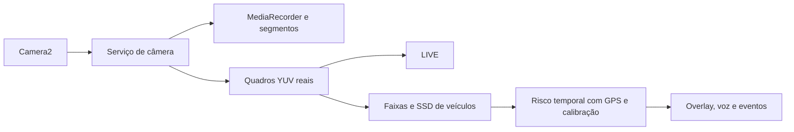

## Download do código-fonte

[Baixar o ZIP completo](https://github.com/oinavile2-max/ADAS-oinavile/raw/refs/heads/main/DashCam_Fonte.zip) ou use **Code → Download ZIP** neste repositório.

O projeto está completo também nesta branch. A entrega é experimental; os resultados e as limitações estão em `RELATORIO_TECNICO.md`.

# DashCam ADAS PRO — 3.1.0 experimental

Código Android com LIVE de quadros reais Camera2, captura/gravação em serviço de primeiro plano e pipeline experimental LDW/FCW. targetSdk/compileSdk 35, minSdk 24, JDK 17, Gradle 8.9.

Veja [RELATORIO_TECNICO.md](RELATORIO_TECNICO.md) e [MATRIZ_REQUISITOS.md](MATRIZ_REQUISITOS.md). Não confundir código implementado e testes JVM/vídeo com validação em dispositivo ou prontidão comercial. Documentos V4.x anteriores e logs históricos não representam o estado atual.

## Compilar

Linux/macOS: configure JDK 17 e ANDROID_HOME com Platform 35/Build Tools 35.0.0, então execute `./gradlew --no-daemon :app:assembleDebug :app:testDebugUnitTest :app:lintDebug`.
Windows: execute `GERAR APK.bat`. APK: `APK_GERADO/DashCam_ADAS_PRO_DEBUG.apk`.

## Fluxo

Na LIVE escolha câmera/orientação e calibre no botão ADAS com o veículo parado. Confirme medidas reais; alarmes exigem GPS válido e detecções confiáveis. Os limites de desenvolvimento são ajustáveis. REC permanece sob responsabilidade do serviço ao sair da Activity, sujeito às restrições do sistema/hardware. Encerrar câmera na notificação fecha a sessão.

Modelo oficial Google Coral, Apache-2.0, pesos/checksum/proveniência em app/src/main/assets. Bibliotecas CPU para ARM32/ARM64. UVC/protocolo proprietário não é garantido por descobrir um USB.

Teste real preparado: `python3 build-tools/test_android_device.py --help`. Nesta nuvem não houve aparelho conectado nem teste físico aprovado. A análise do vídeo recebido teve cobertura baixa; não demonstrou LDW/FCW operacional em trânsito.
